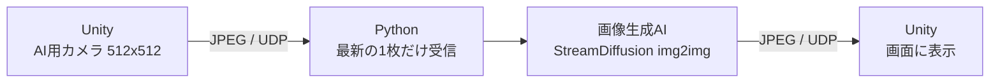
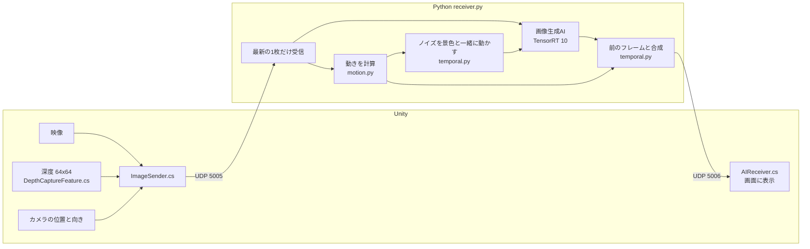

# リアルタイムAIニューラルレンダリングシステム

Unityで作った3Dの村の映像を、ローカルPCの画像生成AIでリアルタイムに写実的な映像へ描き直し、Unityに戻して表示するシステムです。
プレイヤーはUnityの中を歩き回り、AIが描き直した映像を見ながら操作できます。


*左端がUnityの映像(入力)、右の3列がAIで描き直した映像。上段は古い指示文、下段はシーンに合わせた指示文。*

## デモ
[デモ動画](https://youtu.be/PIlJGV8Vlp0)

## 成果のまとめ

| 項目 | 改善前 | 改善後 | 補足 |
|---|---|---|---|
| 操作してから映像が変わるまでの遅れ | 約3秒 | **約0.2秒** | 体感 |
| 1秒あたりに描き直せる枚数 | 7.2枚 | **12.5枚** | 改善前はGPU対応直後の値。Unityと同時に実行 |
| AIの処理時間(1枚あたり) | 94.7ms | **48.1ms** | Unityなし、同じ条件で比較(約2倍速) |
| ちらつき | 7.83 | **3.02(−61%)** | 隣り合うフレームの色の差 |
| 模様が少しずつ変わる量 | 12.47 | **4.89(−61%)** | 10フレーム離れたフレームの色の差 |
| AIによる描き変えの量 | 15.55 | 14.03 | 写実性はほぼ保ったまま、ちらつきを減らした |
| 物陰の虹色の縞(同じノイズの割合) | 86% | **0%** | 合成した場面で再現して測定 |
| 静止中の画面の変化 | 変わり続ける | **0** | わずかな揺れを与えて測定 |

ちらつきの数値は、カメラの横移動を再現した60フレームで測定した色の差(0〜255の平均)。詳しくは [docs/flicker_results.md](docs/flicker_results.md)。

### 理想的な環境でのテスト
一定の速さでカメラを横に動かしたときのAIの出力です。対策なしでは模様がフレームごとに描き直されますが、対策ありでは模様の大半が景色に付いたまま動きます。

| 対策なし | 対策あり |
|---|---|
|  |  |

※ 画像を平行移動させただけの理想的な条件です。実際のUnityの映像では、奥行きによる見え方の違いなどがあるため、ここまでの効果は出ません。

---

## 1. 動機

Google DeepMindの「Genie 3」は、AIが世界そのものを生成し、その中を自由に動き回れる技術です。
ただし、1分以上その世界にいると地形や配置が崩れ、来た道を戻っても異なる世界になってしまう(世界が破綻する)という問題があります。

目的は根本的に異なりますが、**世界の形はあらかじめ3Dモデルで作っておき、AIには見た目の加工だけを任せる**という方法を考えました。

- **世界が破綻しない**: 建物の配置や形は3Dモデルが決める
- **高品質でも容量が小さい**: 作り込みの少ない3Dモデルでも、質感はAIが描き足す
- **低コスト**: 近年のAAAゲームなどで問題になっている、容量や制作費の削減につながる

## 2. 最初に作った仕組み



Unity内の映像をPythonに送り、Python上のAIで描き直して、Unityに送り返します。リアルタイムで動かすために、主に次の4つの工夫をしました。

| 工夫 | 内容 |
|---|---|
| 再送を待たないUDP | 映像は最新の1枚が届けばよいので、TCPのように届かなかったデータの再送を待たない |
| 1フレーム = 1パケット | 512×512の映像は圧縮しないと約1MBになる。UDPは1回に約64KBしか送れないため、JPEGに圧縮して1回の送信に収める |
| 古いフレームは捨てる | 処理が追いつかないときは溜まった映像を読み捨て、常に最新の1枚だけを処理する。表示されないフレームを処理しない |
| 少ない段数で描くAI | StreamDiffusionのような、リアルタイムで動かせる仕組みを使い、元の映像から3段階で描き直すことで建物の配置を保つ |

そのほか、軽量な画像変換(TinyVAE)、半精度計算、指示文を効かせる処理(CFG)を省いて計算量を半分にする、起動時のウォームアップなども行っています。

## 3. 見えてきた課題

動かすことはできましたが、目標とは離れていました。

| 課題 | 調べて分かった原因 |
|---|---|
| 約3秒の遅れ | ディープラーニング用ライブラリ(PyTorch)のバージョンが混ざって壊れていた。AIのライブラリがRTX 5070に対応しておらず、高速化ツール(TensorRT)もエラーを出さずに無効になっていた |
| 画質が低い | 変化を分かりやすくしようと、汎用のAIモデルへの指示文(レンガの家、黒い屋根)を実際の村(白い壁、わらぶき屋根)と異なるものにしていたことが裏目に出て、品質が落ちていた |
| 模様のちらつき | AIは毎フレームを1枚ずつ描き直し、前に描いた模様を覚えていない。描くもとになるノイズも画面に固定されていた |

## 4. 課題の解決

### 解決1: 遅れ(約3秒 → 約0.2秒)
- **壊れた環境を一から作り直す**: RTX 5070に対応したAIライブラリ(PyTorch, CUDA 12.8版)で、必要なものだけを入れ直した
- **TensorRTをRTX 50シリーズに対応**: StreamDiffusion付属の古いバージョン向けのコードを、TensorRT 10に合わせて書き直した(`trt_accel/`)。出力の画像は変わらない
- 処理時間を計測する仕組みを入れ、AIの処理が全体の約87%を占めることを確かめてから高速化した
- AIの処理時間は94.7ms → 48.1ms(約2倍速)

### 解決2: 画質
- **モデルを比較**: 3つのモデル(Stable Diffusion 1.5、Realistic Vision V5.1、DreamShaper 8)を同じ映像で比べ、写実系のRealistic Vision V5.1に変更。速度は同じ
- **指示文を村に合わせる**: 古い指示文では奥の家並みが畑に変わるなど、建物の形まで崩れた。シーンに合わせて書き直すと、建物の配置が残った

### 解決3: ちらつき(−61%)



画像生成AIは、ノイズと呼ばれるランダムな模様をもとに絵を描きます。このノイズが画面に固定されていると、カメラが動いたときに模様もカメラに合わせて動くため、ちらつきが発生します。

このシステムではUnityから**正確な深度(カメラから建物までの距離)とカメラの動き**が分かるので、それを映像と一緒に送り、各点の動きを計算しました。

- **ノイズを景色と一緒に動かす**: ゆっくりした変化(模様が少しずつ別物に変わる)を抑える
- **前のフレームの結果と合成する**: 前の出力を動いた分だけずらして混ぜ、隣り合うフレームの差を抑える
- 2つを合わせて、ちらつき −61%

**そのほかの改善**
- 止まっていても画面が変わる問題を修正(プレイヤーの物理演算でカメラがわずかに回り続けていたのが原因)
- 物陰から新しい景色が現れたときの虹色の縞を解消(深度から「前のフレームでは隠れていた部分」を判定し、新しいノイズを割り当てた)
- Unityを止めるとPythonも自動で終了する

## 5. 限界と今後

**細部の変化は、今回の仕組みでは修正できません。**
AIは毎フレームを1枚ずつ描き直すため、カメラを動かすと細部の見た目は少しずつ変わります。対策で約6割減らしましたが、完全にはなくせません。

今後は、AIが描いた結果を3Dモデルの表面(テクスチャ)に記憶させるなど、仕組みそのものを変えて解決したいと考えています。同じ場所がいつも同じ見た目になります。

### 検証したが採用しなかったこと
- **前のフレームの結果を引き継ぐ方式**: AIの描き変えが積み重なって元の村と違う景色になりやすく、抑えると写実性が下がった
- **近傍クランプ**(ゲームの残像対策の手法): 残像は減るが安定性も下がった
- **描き直しの段数を減らす**: 速くなるが、画質の低下が目立った

## 6. 使用したツール

| 分類 | ツール・素材 |
|---|---|
| 3D・描画 | Unity 6.3 (6000.3.7f1)、Universal Render Pipeline 17.3 |
| 3D素材 | Stylized Medieval Thatched Roof House (Davidweber01) |
| 言語 | C# (Unity側)、Python 3.10 (AI側) |
| 画像生成AI | StreamDiffusion、Realistic Vision V5.1 (Stable Diffusion 1.5系)、LCM-LoRA (latent-consistency/lcm-lora-sdv1-5)、TinyVAE (madebyollin/taesd) |
| 比較したモデル | Stable Diffusion 1.5 (runwayml)、DreamShaper 8 |
| AIライブラリ | PyTorch 2.11 (CUDA 12.8)、diffusers 0.24、transformers 4.40、Hugging Face Hub |
| 高速化 | TensorRT 10.16、ONNX、ONNX Runtime、Polygraphy、cuda-python |
| 画像処理・数値計算 | OpenCV 4.10、NumPy 1.26、Pillow |
| 通信 | UDP (Pythonのsocket、.NETのUdpClient) |
| 開発支援 | Git / GitHub、Claude Code、Gemini |
| 実行環境 | Windows 11、NVIDIA GeForce RTX 5070 (VRAM 12GB)、Intel Core i5-12400、メモリ32GB |

## 7. 動作環境とセットアップ

### 必要なもの
- Windows 10 / 11
- NVIDIA RTX 50シリーズなど(VRAM 12GB以上を推奨)
- Python 3.10
- Unity 6.3 (6000.3.7f1)

### Python
```bash
py -3.10 -m venv venv
venv/Scripts/python.exe -m pip install torch torchvision --index-url https://download.pytorch.org/whl/cu128
venv/Scripts/python.exe -m pip install -r requirements.txt
venv/Scripts/python.exe -m pip install --no-deps "git+https://github.com/cumulo-autumn/StreamDiffusion.git@b623251dc055e1fd858d53509aa43e09dfc5cdc0"
```
- 初回起動時にモデル(約4GB)をダウンロードし、TensorRTのエンジンを作成する(数分)。2回目以降は約8秒で起動する
- モデルの保存先を変える場合は、環境変数 `HF_HOME` を設定する

### Unity
1. `simple village2` をUnity Hubで開く
2. `Assets/Settings/PC_Renderer` の Renderer Features に **Depth Capture Feature** が入っていることを確認する
3. `Assets/Scenes/SampleScene` を開く

### 実行
```bash
venv/Scripts/python.exe receiver.py
```
起動後にUnityで再生する。Unityの再生を止めると約3秒でPythonも終了する(ウィンドウを閉じる、`q` キーでも終了)。

### 主な設定(`receiver.py` の先頭)
| 設定 | 内容 |
|---|---|
| `MODEL_ID` | 使うAIモデル |
| `T_INDEX_LIST` | AIが描き変える強さ。数字が小さいほど大きく描き変える(写実的になるが、元の配置から離れやすく、ちらつきも増える) |
| `USE_NOISE_WARP` / `BLEND_ALPHA` | ちらつき対策のオン・オフと、前のフレームを混ぜる割合 |
| `BLEND_CLAMP` | 残像対策の強さ(1で無効) |

## 8. フォルダ構成

| パス | 内容 |
|---|---|
| `receiver.py` | Python側の本体(受信・AI・ちらつき対策・送信) |
| `motion.py` | Unityからのデータの読み取り、深度とカメラの動きからモーションベクトルと隠れ判定を計算 |
| `temporal.py` | ちらつき対策(ノイズの移動、前のフレームとの合成) |
| `wrapper.py` | StreamDiffusionの呼び出し |
| `trt_accel/` | TensorRT 10対応版の高速化コード(StreamDiffusionから取り込んで修正、Apache License 2.0) |
| `tools/measure_flicker.py` | ちらつきを数値で測るツール |
| `docs/` | 発表スライド(.pptx)と台本、説明資料、質問対策メモ、比較画像、ちらつき測定の結果 |
| `simple village2/Assets/ImageSender.cs` | Unityの映像・深度・カメラの位置と向きをPythonへ送る |
| `simple village2/Assets/DepthCaptureFeature.cs` | カメラの深度を小さい画像にコピーする |
| `simple village2/Assets/AIReceiver.cs` | AIが描き直した映像を受け取って表示する |
