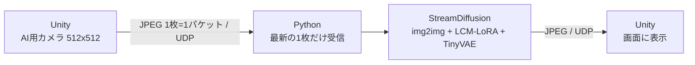
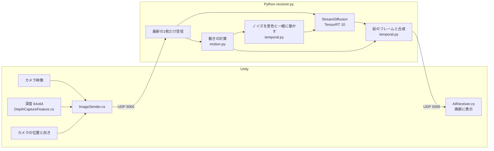

# リアルタイムAIニューラルレンダリングシステム

Unityで描いたシンプルな3Dの村の映像を、ローカルの画像生成AIでリアルタイムに写実的な映像へ描き直し、Unityに戻して表示するシステムです。
プレイヤーはUnityの中を歩き回り、AIが描き直した映像を見ながら操作できます。


*左端がUnityの映像(入力)、右の3列がAIで描き直した映像。*

## デモ
[デモ動画](https://youtu.be/PIlJGV8Vlp0)

## 成果のまとめ

| 項目 | 最初の実装 | 現在 |
|---|---|---|
| 操作してから映像が変わるまでの遅れ(体感) | 約3秒 | **約0.2秒** |
| 1秒あたりに描き直せる枚数 | 7.2枚(GPUに対応させた直後) | **12.5枚** |
| AIの処理時間(1枚あたり、同じ条件で測定) | 94.7ms | **48.1ms**(約2倍速) |
| カメラを動かしたときのちらつき | 7.83 | **3.02(−61%)** |
| 模様が少しずつ別物に変わる量 | 12.47 | **4.89(−61%)** |
| 物陰から景色が現れたときの虹色の縞 | 発生 | **解消** |

ちらつきの数値は `tools/measure_flicker.py` で測定(詳しくは [docs/flicker_results.md](docs/flicker_results.md))。
前提を知らない人向けの説明は [docs/presentation.html](docs/presentation.html) にまとめています。

| ちらつき対策なし | ちらつき対策あり |
|---|---|
|  |  |

---

## 1. 経緯と狙い

Google DeepMindの「Genie 3」のように、AIが映像そのものを生成して操作できる世界を作る技術が出てきています。
ただ、AIが世界をゼロから生成し続けると、時間がたつにつれて建物の形や配置が崩れる(世界が破綻する)ことがあります。

そこで、**世界の形はあらかじめ3Dモデルで作っておき、AIには見た目の加工だけを任せる**という方法を考えました。

- 建物の配置や形は3Dモデルが決めるので、世界が破綻しない
- 細かな質感はAIが描き足すので、作り込みの少ない(容量の小さい)3Dモデルでも写実的な映像になる
- ローカルのAIで動かすので、利用料などのコストがかからない

これを、**手元のPCで、操作できる速さ(リアルタイム)で動かす**ことを目標にしました。

## 2. 最初に作った仕組みと工夫



リアルタイムで動かすために、最初の実装の時点で次の工夫をしていました。

| 工夫 | 内容と理由 |
|---|---|
| UnityとPythonを分ける | 3Dの描画はUnity、AIはPythonと、それぞれ得意な環境で動かし、同じPCの中で通信する |
| TCPではなくUDPで通信 | TCPは届かなかったデータを再送して待つため、遅れが出る。映像は最新の1枚が届けばよいので、待たないUDPを選んだ |
| 1フレームをJPEGで1パケットに収める | 映像をJPEGに圧縮し、UDPの1回の送信(約64KB)に収めた。分割や再組み立てが不要になる |
| 古いフレームを捨てて最新の1枚だけ処理 | AIの処理が追いつかないと、届いた映像が溜まって遅れが積み重なる。溜まった分を読み捨て、常に最新の映像だけを処理する |
| AI用のカメラと解像度を固定 | 画面表示とは別のカメラで512x512の画像を作り、Unityの送信は30fpsに固定。AIの入力をいつも同じ大きさ・量にする |
| StreamDiffusionで高速に描き直す | 画像生成AIを動画向けに高速化する仕組み。複数フレームの処理をずらして並行して進める |
| img2img(元の画像から描き直す) | ゼロから描かず、Unityの映像にノイズを足してから描き直すことで、建物の配置を保つ |
| LCM-LoRA / TinyVAE / 半精度 | 通常は数十段階かかる描画を3段階で済ませるLCM-LoRA、軽量な画像変換のTinyVAE、半精度計算で処理を軽くする |
| CFGを使わない | 指示文の効きを強める処理(CFG)はAIの計算が倍になるため、使わずに速さを優先した |
| 乱数の固定と、ネガティブプロンプトの絞り込み | フレームごとに結果がばらつかないよう、乱数を固定し、避けたい要素の指示を必要最低限にした |
| 起動時のウォームアップ | 最初の数フレームが遅くならないよう、映像を受け取る前に空の画像でAIを動かしておく |
| TensorRTでの高速化(を想定) | NVIDIAの高速化ツールでAIの計算を最適化する設定にしていた |
| 比較用のウィンドウ | AIの出力をPython側でも表示し、Unityの映像と見比べられるようにした |

## 3. 見えてきた課題

この仕組みで動かすことはできましたが、目標とは離れた状態でした。

- **操作してから映像が変わるまでに約3秒の遅れ**があった
- **画質が低かった**
- **カメラを動かすと、模様がちらついた**

調べると、次の原因が見つかりました。

| 課題 | 原因 |
|---|---|
| 約3秒の遅れ | Pythonの環境で複数のバージョンのライブラリが混ざって壊れていた。動いていたPyTorch(AIの計算ライブラリ)はRTX 5070(RTX 50シリーズ)に対応していなかった。TensorRTも、必要なライブラリが入っておらず、しかもRTX 50シリーズに対応していない古いバージョンだったため、エラーを表示せずに**高速化なしで動いていた** |
| 画質が低い | 汎用のAIモデルを使っていた。指示文が「オレンジのレンガの家、黒い屋根」で、実際の村(白い漆喰の壁、わらぶき屋根)と食い違っていた |
| ちらつき | AIは毎フレームを独立した1枚として描き直し、前に描いた模様を覚えていない。さらに、AIに与えるノイズが画面に固定されているため、カメラが動くと模様が建物の上を滑る |

## 4. 改善の取り組み



### 4-1. 実行環境の作り直し(遅れ 約3秒 → 約0.4秒)
- 壊れた環境を部分的に直すより確実なため、RTX 5070に対応したPyTorch(CUDA 12.8版)で環境を一から作り直した
- 必要なライブラリだけを書いた `requirements.txt` に整理した

### 4-2. 処理時間の計測
- 受信・AI・表示・送信のそれぞれの時間を1秒ごとに表示するようにした
- AIの処理が全体の約87%を占めていると分かり、ここを速くすることにした

### 4-3. TensorRTをRTX 50シリーズに対応させる(AI 94.7ms → 48.1ms)
- StreamDiffusion付属のTensorRT用コードはTensorRT 8〜9向けで、RTX 50シリーズに必要なTensorRT 10では動かない
- コードを `trt_accel/` に取り込み、削除された命令の置き換えなどを行って対応させた。高速化の前後で出力が同じ画像になることも確認した
- 結果として、約12.5fps、遅れ約0.2秒になった

### 4-4. モデルと指示文の見直し
- 3つのAIモデルを同じ画像で比べ、写実系のモデル(Realistic Vision V5.1)に変えた。速度は変わらない
- 指示文が村の見た目とずれていると、奥の家並みが畑に変わるなど、建物の形まで崩れることが分かった。指示文を実際のシーンに合わせた

### 4-5. ちらつきを数値で測る仕組み
- 画像を少しずつ横にずらして「カメラの横移動」を再現し、AIの出力を移動量だけずらして重ねたときの差を測るツールを作った
- 「なんとなく良くなった」ではなく、数値で対策の効果を判断できるようにした

### 4-6. Unityの3D情報を使ったちらつき対策(ちらつき −61%)
映像だけを見るAIと違い、このシステムではUnityから**正確な深度(カメラからの距離)とカメラの動き**が得られる。これを使った。
- **動きの計算**: Pythonは追いつかないフレームを捨てているため、Unityの「1フレーム前からの動き」は使えない。
  深度とカメラの位置・向きを送り、処理するフレーム同士の動きをPythonで計算した(理論値と一致、実機でも映像から推定した動きと一致)
- **ノイズを景色に張り付ける**: ノイズを景色と一緒に動かした。素直にずらすと逆に悪化した(+23%)ため原因を調べ、
  AIの計算の単位(8x8画素のマス目)に合わせて動かす方式にした
- **前のフレームとの合成**: 前のフレームの出力を動いた分だけずらし、今の出力と混ぜる。
  ノイズの移動は「ゆっくりした変化」を、合成は「隣り合うフレームの差」を抑え、役割を分担している

### 4-7. 静止中の安定化
- 止まっていても画面が変わり続ける問題があった。カメラの移動量・回転量を表示して調べると、カメラが1フレームに0.031°ずつ回り続けていた
- プレイヤーの物理演算で回転が固定されていなかったのが原因。設定を直し、1ピクセル未満の動きは静止として扱うようにした

### 4-8. 物陰の虹色の縞を解消
- 建物の陰から景色が現れる場面で、虹色の縞が出ていた。手前の板と奥の壁だけの場面で再現すると、ノイズが横に引き伸ばされていた(隣り合うマスの86%が同じ値)
- 深度から「前のフレームでは隠れていた部分」を判定し、新しいノイズを割り当てて解消した(0%)

### 4-9. 使い勝手
- Unityの再生を止めると約3秒でPythonも終了する。映像を待つ間もウィンドウの処理を続け、「応答なし」にならないようにした

## 5. 仕組み上の限界: 見た目がフレームごとに少し変わること

このシステムは、**毎フレームの映像を1枚の画像としてAIに描き直させています**。
AIは前のフレームで何を描いたかを覚えていないため、カメラが動いて入力が少し変わると、壁の模様や細部が描き直され、見た目が少しずつ変わります。
上記の対策で変化の量は約6割減らしましたが、**1枚ずつ描き直す仕組みである以上、完全になくすことはできません**。

根本的に解決するには、AIが描いた結果を3Dモデルの表面(テクスチャ)に焼き付けてUnityで描画するなど、仕組み自体を変える必要があります。

### 検証したが採用しなかったこと
- **前のフレームの結果を引き継ぐ方式**: AIの描き始めに前の結果を混ぜる方式。シミュレーションでは上乗せで約2割改善したが、
  AIの描き変えが雪だるま式に積み重なって元の村と違う景色になりやすく、抑えると写実性が下がった。実機で見比べて採用しなかった
- **近傍クランプ**(ゲームの残像対策の手法): 残像は減るが安定性も下がり、虹色の縞には効果がなかったため既定では無効
- **描き直しの段数を減らす**: 3段階を2段階にすると速くなるが、画質の低下が目立った

## 6. 使っている技術とバージョン

| 分類 | 内容 |
|---|---|
| 3D環境 | Unity 6.3 (6000.3.7f1), URP 17.3 |
| AI | StreamDiffusion, Realistic Vision V5.1 (Stable Diffusion 1.5系) + LCM-LoRA + TinyVAE |
| 高速化 | TensorRT 10.16, PyTorch 2.11 (CUDA 12.8) |
| 通信 | UDP (Unity → Python: 5005番, Python → Unity: 5006番) |
| 開発環境 | Windows 11, RTX 5070 (VRAM 12GB), Core i5-12400, メモリ32GB, Python 3.10 |

## 7. 動作環境とセットアップ

### 必要なもの
- Windows 10 / 11
- NVIDIA RTX 50シリーズなど(VRAM 12GB以上を推奨)
- Python 3.10
- Unity 6.3 (6000.3.7f1)

### Python
```bash
py -3.10 -m venv venv
venv/Scripts/python.exe -m pip install torch torchvision --index-url https://download.pytorch.org/whl/cu128
venv/Scripts/python.exe -m pip install -r requirements.txt
venv/Scripts/python.exe -m pip install --no-deps "git+https://github.com/cumulo-autumn/StreamDiffusion.git@b623251dc055e1fd858d53509aa43e09dfc5cdc0"
```
- 初回起動時にモデル(約4GB)をダウンロードし、TensorRTのエンジンを作成する(数分)。2回目以降は約8秒で起動する
- モデルの保存先を変える場合は、環境変数 `HF_HOME` を設定する

### Unity
1. `simple village2` をUnity Hubで開く
2. `Assets/Settings/PC_Renderer` の Renderer Features に **Depth Capture Feature** が入っていることを確認する
3. `Assets/Scenes/SampleScene` を開く

### 実行
```bash
venv/Scripts/python.exe receiver.py
```
起動後にUnityで再生する。Unityの再生を止めると約3秒でPythonも終了する(ウィンドウを閉じる、`q` キーでも終了)。

### 主な設定(`receiver.py` の先頭)
| 設定 | 内容 |
|---|---|
| `MODEL_ID` | 使うAIモデル |
| `T_INDEX_LIST` | AIが描き変える強さ。数字が小さいほど大きく描き変える(写実的になるが、元の配置から離れやすく、ちらつきも増える) |
| `USE_NOISE_WARP` / `BLEND_ALPHA` | ちらつき対策のオン・オフと、前のフレームを混ぜる割合 |
| `BLEND_CLAMP` | 残像対策の強さ(1で無効) |

## 8. フォルダ構成

| パス | 内容 |
|---|---|
| `receiver.py` | Python側の本体(受信・AI・ちらつき対策・送信) |
| `motion.py` | Unityからのデータの読み取り、深度とカメラの動きからモーションベクトルと隠れ判定を計算 |
| `temporal.py` | ちらつき対策(ノイズの移動、前のフレームとの合成) |
| `wrapper.py` | StreamDiffusionの呼び出し |
| `trt_accel/` | TensorRT 10対応版の高速化コード(StreamDiffusionから取り込んで修正、Apache License 2.0) |
| `tools/measure_flicker.py` | ちらつきを数値で測るツール |
| `docs/` | 比較画像、ちらつき測定の結果([flicker_results.md](docs/flicker_results.md))、発表用資料([presentation.html](docs/presentation.html)) |
| `simple village2/Assets/ImageSender.cs` | Unityの映像・深度・カメラの位置と向きをPythonへ送る |
| `simple village2/Assets/DepthCaptureFeature.cs` | カメラの深度を小さい画像にコピーする |
| `simple village2/Assets/AIReceiver.cs` | AIが描き直した映像を受け取って表示する |
