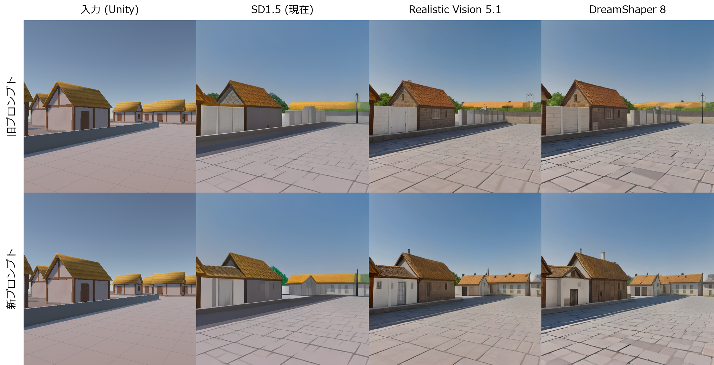
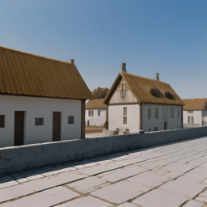
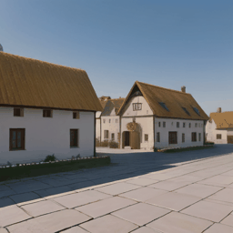
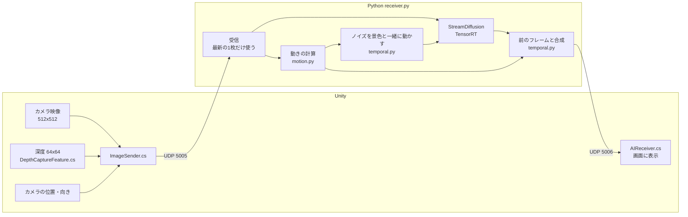

# リアルタイムAIニューラルレンダリングシステム

Unityで描いたシンプルな3Dの村の映像を、ローカルの画像生成AIでリアルタイムに写実的な映像へ描き直し、Unityに戻して表示するシステムです。
プレイヤーはUnityの中を歩き回り、AIが描き直した映像を見ながら操作できます。

| Unityの映像(入力) | AIが描き直した映像(出力) |
|---|---|
| シンプルなCG | 漆喰の壁・木組み・わらぶき屋根・石畳の質感が付いた写実的な映像 |



## デモ
[デモ動画](https://youtu.be/PIlJGV8Vlp0)

## 成果(改善前 → 改善後)

| 項目 | 改善前 | 改善後 |
|---|---|---|
| 操作してから映像が変わるまでの遅れ(体感) | 約3秒 | **約0.2秒** |
| 1秒あたりに描き直せる枚数 | 計測不能(約3秒遅れ) | **約12.5枚** |
| AIの処理時間(1枚あたり) | 121ms(GPU対応後の値) | **48ms**(TensorRTで約2倍速) |
| カメラを動かしたときのちらつき | 7.83 | **3.02(−61%)** |
| 模様が少しずつ別物に変わる量 | 12.47 | **4.89(−61%)** |
| 止まっているときの画面の変化 | — | **0**(わずかな揺れでも変わらない) |
| 物陰から景色が現れたときの虹色の縞 | 発生 | **解消** |

ちらつきの数値は `tools/measure_flicker.py` で測定(詳しくは [docs/flicker_results.md](docs/flicker_results.md))。

| 対策なし | 対策あり |
|---|---|
|  |  |

## 仕組み



1. **Unity** がカメラ映像(JPEG)に、深度(カメラから各画素までの距離)とカメラの位置・向きを添えてPythonへ送る
2. **Python** は届いた中で最新の1枚だけを処理する(古い映像が溜まって遅れが積み重なるのを防ぐ)
3. 深度とカメラの位置・向きから、**前に処理したフレームから各画素がどれだけ動いたか**を計算する
4. **StreamDiffusion**(画像生成AIを高速に動かす仕組み)で映像を写実的に描き直す。その際、AIに与えるノイズを景色と一緒に動かす
5. 描き直した映像を前のフレームの結果と合成してちらつきを抑え、Unityへ送り返す

### 使っている技術とバージョン

| 分類 | 内容 |
|---|---|
| 3D環境 | Unity 6.3 (6000.3.7f1), URP 17.3 |
| AI | StreamDiffusion, Realistic Vision V5.1 (Stable Diffusion 1.5系) + LCM-LoRA + TinyVAE |
| 高速化 | TensorRT 10.16, PyTorch 2.11 (CUDA 12.8) |
| 通信 | UDP (Unity → Python: 5005番, Python → Unity: 5006番) |
| 開発環境 | Windows 11, RTX 5070 (VRAM 12GB), Core i5-12400, メモリ32GB, Python 3.10 |

## 工夫した点

### 1. RTX 50シリーズでGPUとTensorRTを正しく動かす
- 元の環境では、PyTorchがRTX 5070(Blackwell世代)に対応しておらず、TensorRTも初期化に失敗して高速化なしで動いていた。これが約3秒の遅れの主な原因だった
- 対応するPyTorch(CUDA 12.8版)で環境を作り直した
- StreamDiffusion付属のTensorRT用コードはTensorRT 8〜9向けで、RTX 50シリーズに必要なTensorRT 10では動かない。
  `trt_accel/` に取り込み、削除されたAPIの置き換えなどを行って対応させた(AIの処理時間 94.7ms → 48.1ms)

### 2. 写実的なモデルと、シーンに合ったプロンプト
- 汎用のSD1.5から写実系モデル(Realistic Vision V5.1)に変更。速度は変わらない
- プロンプト(AIへの指示文)が実際の村の見た目とずれていると、奥の家並みが畑に変わるなど建物の形まで崩れることが分かり、シーンに合わせた

### 3. ちらつきを数値で測る仕組み
- 画像を少しずつ横にずらして「カメラの横移動」を再現し、AIの出力を移動量だけずらして重ねたときの差を測るツールを作成
- 「なんとなく良くなった」ではなく、数値で改善を判断できるようにした

### 4. Unityの3D情報を使ったちらつき対策
映像だけを見るAIと違い、このシステムではUnityから**正確な深度とカメラの動き**が得られる。これを使った。
- **動きの計算**: Pythonは処理が間に合わないフレームを捨てるため、Unityの「1フレーム前からの動き」は使えない。
  そこで深度とカメラの位置・向きから、処理するフレーム同士の動きをPython側で計算した(理論値と一致、実機でも映像から推定した動きと一致)
- **ノイズを景色に張り付ける**: AIは「ノイズ」から絵を描くため、ノイズが画面に固定されていると、カメラが動いたときに模様が建物の上を滑る。
  ノイズを景色と一緒に動かした。素直にずらすと逆に悪化した(+23%)ため、原因を調べてAIの計算の単位(8x8画素のマス目)に合わせて動かす方式にした
- **前のフレームとの合成**: 前のフレームの出力を動きに合わせてずらし、今の出力と混ぜる
- **静止中の安定化**: カメラのわずかな回転で画面が変わり続ける問題を、カメラの移動量・回転量を表示して原因を特定し、修正した
- **物陰の対策**: 物陰から景色が現れた部分ではノイズが横に引き伸ばされ、虹色の縞になっていた(隣り合うマスの86%が同じ値)。
  深度から「前のフレームでは隠れていた部分」を判定し、新しいノイズを割り当てて解消した(0%)

## 仕組み上の限界: 見た目がフレームごとに少し変わること

このシステムは、**毎フレームの映像を1枚の画像としてAIに描き直させています**。
AIは前のフレームで何を描いたかを覚えていないため、カメラが動いて入力が少し変わると、壁の模様や細部が描き直され、見た目が少しずつ変わります。
上記の対策で変化の量は約6割減らしましたが、**1枚ずつ描き直す仕組みである以上、完全になくすことはできません**。

根本的に解決するには、AIが描いた結果を3Dモデルの表面(テクスチャ)に焼き付けてUnityで描画するなど、仕組み自体を変える必要があります。

### 検証したが採用しなかったこと
- **前のフレームの結果を引き継ぐ方式**: AIの描き始めに前の結果を混ぜる方式。シミュレーションでは上乗せで約2割改善したが、
  AIの描き変えが雪だるま式に積み重なって元の村と違う景色になりやすく、抑えると写実性が下がった。実機で見比べて採用しなかった
- **近傍クランプ**(ゲームの残像対策の手法): 残像は減るが安定性も下がり、虹色の縞には効果がなかったため既定では無効

## 動作環境とセットアップ

### 必要なもの
- Windows 10 / 11
- NVIDIA RTX 50シリーズなど(VRAM 12GB以上を推奨)
- Python 3.10
- Unity 6.3 (6000.3.7f1)

### Python
```bash
py -3.10 -m venv venv
venv/Scripts/python.exe -m pip install torch torchvision --index-url https://download.pytorch.org/whl/cu128
venv/Scripts/python.exe -m pip install -r requirements.txt
venv/Scripts/python.exe -m pip install --no-deps "git+https://github.com/cumulo-autumn/StreamDiffusion.git@b623251dc055e1fd858d53509aa43e09dfc5cdc0"
```
- 初回起動時にモデル(約4GB)をダウンロードし、TensorRTのエンジンを作成する(数分)。2回目以降は約8秒で起動する
- モデルの保存先を変える場合は、環境変数 `HF_HOME` を設定する

### Unity
1. `simple village2` をUnity Hubで開く
2. `Assets/Settings/PC_Renderer` の Renderer Features に **Depth Capture Feature** が入っていることを確認する
3. `Assets/Scenes/SampleScene` を開く

### 実行
```bash
venv/Scripts/python.exe receiver.py
```
起動後にUnityで再生する。Unityの再生を止めると約3秒でPythonも終了する(ウィンドウを閉じる、`q` キーでも終了)。

### 主な設定(`receiver.py` の先頭)
| 設定 | 内容 |
|---|---|
| `MODEL_ID` | 使うAIモデル |
| `T_INDEX_LIST` | AIが描き変える強さ。数字が小さいほど大きく描き変える(写実的になるが、元の配置から離れやすく、ちらつきも増える) |
| `USE_NOISE_WARP` / `BLEND_ALPHA` | ちらつき対策のオン・オフと、前のフレームを混ぜる割合 |
| `BLEND_CLAMP` | 残像対策の強さ(1で無効) |

## フォルダ構成

| パス | 内容 |
|---|---|
| `receiver.py` | Python側の本体(受信・AI・ちらつき対策・送信) |
| `motion.py` | Unityからのデータの読み取り、深度とカメラの動きからモーションベクトルと隠れ判定を計算 |
| `temporal.py` | ちらつき対策(ノイズの移動、前のフレームとの合成) |
| `wrapper.py` | StreamDiffusionの呼び出し |
| `trt_accel/` | TensorRT 10対応版の高速化コード(StreamDiffusionから取り込んで修正、Apache License 2.0) |
| `tools/measure_flicker.py` | ちらつきを数値で測るツール |
| `docs/` | 比較画像、ちらつき測定の結果([flicker_results.md](docs/flicker_results.md))、発表用資料([presentation.html](docs/presentation.html)) |
| `simple village2/Assets/ImageSender.cs` | Unityの映像・深度・カメラの位置と向きをPythonへ送る |
| `simple village2/Assets/DepthCaptureFeature.cs` | カメラの深度を小さい画像にコピーする |
| `simple village2/Assets/AIReceiver.cs` | AIが描き直した映像を受け取って表示する |
